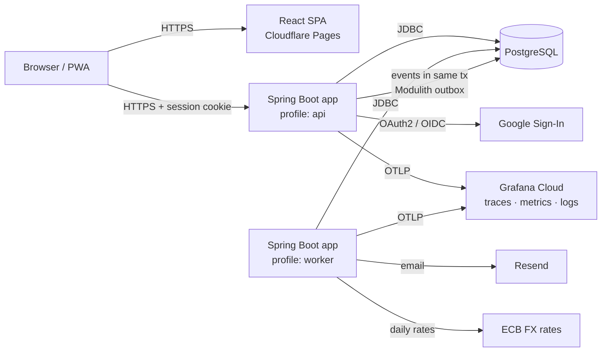

# Architecture — MoneyTrail

## Overview

A **modular monolith** in **Java 25 + Spring Boot 4**, with module boundaries enforced by
**Spring Modulith**. **PostgreSQL** is the only stateful dependency, and the frontend is a
**React + TypeScript SPA**. See [ADR-0002](adr/0002-modular-monolith.md) for why this is
not microservices.

This document describes the target design across all milestones. Features ship in the
[roadmap](roadmap.md) order: a person's income and expenses first, then groups. Receipt
QR scanning (`invoices`) and the other automation modules come later.



| Component | Responsibility |
|---|---|
| App, profile `api` | REST API (`/v1`), authentication, validation, ledger writes, event publication |
| App, profile `worker` | Event listeners and scheduled jobs: recurring transactions, CSV imports, budget alerts, FX rates, nightly ledger invariant check, idempotency key cleanup |
| PostgreSQL | System of record, plus the sessions table, the event publication registry (outbox) and ShedLock locks. No Kafka or Redis to run or pay for |
| Frontend | Vite SPA. Talks to the API through a TypeScript client generated from the OpenAPI spec |

There is one artifact (a single jar / image) running in two roles. Locally and at the
start of production both profiles can run in one process.

## Tech stack

| Concern | Choice |
|---|---|
| Language / runtime | Java 25 (LTS), **virtual threads** enabled |
| Framework | Spring Boot 4, Spring Web MVC |
| Build | Gradle (Kotlin DSL), version catalog `gradle/libs.versions.toml` |
| Modularity | Spring Modulith (`ApplicationModules.verify()` in tests, generated module docs) |
| Persistence | Spring Data JPA (Hibernate) for aggregates. `JdbcClient` for reports and ledger hot paths |
| Migrations | Flyway |
| Events / outbox | Spring Modulith event publication registry (JDBC). Optional Kafka externalisation later |
| Scheduling | `@Scheduled` + **ShedLock** (safe with more than one instance) |
| API contract | OpenAPI 3.1, spec-first, `openapi-generator` (Spring interfaces + TS client) |
| Errors | Spring `ProblemDetail` (RFC 9457) |
| Security | Spring Security OAuth2 Login (Google), Spring Session JDBC, CSRF via cookie token |
| Validation | Jakarta Bean Validation |
| Observability | Actuator, Micrometer, OpenTelemetry (OTLP), structured JSON logging |
| Testing | JUnit, AssertJ, Testcontainers (`@ServiceConnection`), jqwik (property-based), MockMvc, k6 |
| Code quality | Spotless (palantir-java-format), Error Prone + NullAway (JSpecify annotations) |
| Images | Spring Boot `bootBuildImage` (Paketo buildpacks), running as non-root |

### Frontend

| Concern | Choice |
|---|---|
| Build / language | Vite + React + TypeScript (strict) |
| Data fetching | TanStack Query over an `openapi-fetch` client generated from the spec |
| Routing | React Router |
| UI | Tailwind CSS + shadcn/ui, Recharts for charts |
| Forms | React Hook Form + Zod |
| Mobile | PWA (`vite-plugin-pwa`). QR scanning with the browser's `BarcodeDetector`, falling back to `@zxing/browser` |
| i18n | Portuguese and English from day one (`i18next`) |
| Money display | `Intl.NumberFormat` from `amountMinor` + currency, never floating-point maths |

## Module boundaries

Spring Modulith treats every direct subpackage of the root as an application module:

```
io.github.muzachio.moneytrail
├── ledger/      # core: accounts, journal entries, postings, balances. Exposes LedgerService only.
├── personal/    # use cases: expense / income / transfer → ledger entries
├── groups/      # groups, members, invites, splits, settlements → ledger entries
├── budgets/
├── invoices/    # ATCUD QR parsing + merchant memory
├── imports/     # CSV statement import
├── reports/     # read-side queries (spend by category, trends)
├── identity/    # users, Google login, sessions
└── shared/      # Money, idempotency, web/problem handling, config (open module)
```

Rules:
- A module exposes a public API in its root package. Everything in `internal`
  subpackages is private. `ModularityTests` fails the build on violations.
- **Only `ledger` writes to `journal_entries`, `postings` and `account_balances`.**
- Modules communicate through **calls to the public API** (synchronous, same transaction)
  or **domain events** (`@ApplicationModuleListener`: async, after commit, persisted in the
  event publication registry and retried if they fail).
- Controllers are thin: map the request DTO → call the use case → map the response. No
  repositories in controllers.

## The ledger

### Model

Every money movement is a **journal entry** with **two or more postings**.
Amounts are signed `long` in **minor units** (cents): debit is positive, credit is
negative. The postings of an entry **must sum to zero** for each currency. In code,
money is a `Money(long minor, Currency currency)` record. `double` is never used, and
`BigDecimal` only for FX conversion and percentage splits.

Categories *are* ledger accounts of kind `EXPENSE` or `INCOME`, as in Beancount and
GnuCash. This keeps reports a plain `SUM` over postings.

| Account kind | Examples | Normal balance |
|---|---|---|
| `ASSET` | Checking, Savings, Cash | debit (+) |
| `LIABILITY` | Credit card | credit (−) |
| `INCOME` | Salary, Refunds | credit (−) |
| `EXPENSE` | Food, Transport | debit (+) |
| `EQUITY` | Opening balances | credit (−) |
| `GROUP_MEMBER` | Pedro @ Lisbon trip | + is owed by the group, − owes the group |

### Examples

**€12.50 lunch paid with the checking account**

| Account | Amount |
|---|---|
| Expense:Food | +1250 |
| Asset:Checking | −1250 |

**Fixing that it was €15 instead:** reverse the entry (an exact negation, linked through
`reverses_entry_id`), then post a new one. Nothing is ever updated or deleted.

**Group dinner, €30 paid by Pedro, split equally between Pedro, Ana and João**

| Account | Amount | Meaning |
|---|---|---|
| Member:Pedro | +3000 | paid |
| Member:Pedro | −1000 | his share |
| Member:Ana | −1000 | her share |
| Member:João | −1000 | his share |

Balances: Pedro +2000 (is owed €20), Ana −1000, João −1000.
**Ana settles €10 with Pedro:** Member:Ana +1000, Member:Pedro −1000.

**Rounding:** €10 split three ways gives 333 + 333 + 334. Remainders use the
largest-remainder method with a deterministic order (by member id), so the same input
always produces the same split and the total always matches.

**Settle-up suggestions:** greedily match the largest creditor with the largest debtor
until every balance is zero. That gives at most *n − 1* payments.

### Guarantees and how they are enforced

| Guarantee | Enforcement |
|---|---|
| Every entry balances | Validated in `LedgerService` **and** by a deferred constraint trigger on `postings` (`SUM(amount) = 0` per entry and currency, at least 2 postings). jqwik property tests on top |
| History is immutable | Triggers reject `UPDATE`/`DELETE` on `journal_entries` and `postings`. JPA entities are `@Immutable` |
| Balances are correct under concurrency | `account_balances` is updated in the same transaction. Rows are locked with `SELECT … FOR UPDATE` (`@Lock(PESSIMISTIC_WRITE)`) **in ascending account id order** to avoid deadlocks |
| Balances are rebuildable | A nightly job recomputes `SUM(postings)` per account and raises an alert metric on any mismatch with `account_balances` |
| Posting currency = account currency | Check in `LedgerService`, plus a composite FK `(account_id, currency)` |
| Retries don't duplicate | Idempotency keys (below) |

## Data model (first cut)

```sql
users            (id uuid pk, email citext unique, name, avatar_url, created_at)
identities       (provider, subject, user_id fk, pk(provider, subject))
spring_session*  -- managed by Spring Session JDBC

ledgers          (id uuid pk, owner_type text check in ('USER','GROUP'), owner_id uuid)
accounts         (id uuid pk, ledger_id fk, kind text, subtype text, name, currency char(3),
                  archived_at, created_at, unique(id, currency))
journal_entries  (id uuid pk, ledger_id fk, occurred_on date, description, merchant_tax_id,
                  reverses_entry_id fk null unique, created_by fk users, created_at)
postings         (id bigserial pk, entry_id fk, account_id, currency,
                  amount_minor bigint check (amount_minor <> 0),
                  fk(account_id, currency) → accounts(id, currency))
account_balances (account_id pk fk, balance_minor bigint, version bigint, updated_at)

groups           (id uuid pk, name, currency char(3), ledger_id fk, created_by, created_at)
group_members    (group_id, user_id, account_id fk accounts, role, joined_at, pk(group_id, user_id))
group_invites    (token_hash pk, group_id, expires_at, created_by)
expense_splits   (entry_id fk, user_id, method text, input_value numeric, share_minor bigint)

budgets          (id, user_id, account_id (expense category), month date, limit_minor bigint)
recurring_rules  (id, user_id, template jsonb, rrule text, next_run_on date)
merchants        (user_id, tax_id, display_name, default_account_id, pk(user_id, tax_id))

idempotency_keys (user_id, key, request_hash bytea, status, response_code, response_body jsonb,
                  created_at, pk(user_id, key))
audit_log        (id bigserial, actor_id, action, target_type, target_id, data jsonb, at)
event_publication -- managed by Spring Modulith (outbox)
shedlock          -- managed by ShedLock
```

UUIDs are **v7** (time-ordered, index-friendly), generated in the application.

## API

- REST, JSON, versioned under `/v1`, **spec-first** in `api/openapi.yaml` ([ADR-0006](adr/0006-spec-first-openapi.md)).
- Money in JSON is `{ "amountMinor": 1250, "currency": "EUR" }`. No floats on the wire either.
- Errors are **RFC 9457** `ProblemDetail` with a stable `code` property.
- Lists use **cursor pagination** (keyset on `(occurred_on, id)`), never `OFFSET`.
- Every money-moving `POST` **requires an `Idempotency-Key` header**.

Main resources:

```
GET    /v1/me
GET    /oauth2/authorization/google · POST /logout          (Spring Security)

GET|POST         /v1/accounts           PATCH /v1/accounts/{id} (rename/archive only)
GET|POST         /v1/categories
GET|POST         /v1/transactions       GET /v1/transactions/{id}
POST             /v1/transactions/{id}/reverse
GET              /v1/reports/spending?from=&to=&groupBy=category|month

GET|POST         /v1/groups             POST /v1/groups/{id}/invites
POST             /v1/invites/{token}/accept
GET|POST         /v1/groups/{id}/expenses
GET              /v1/groups/{id}/balances
GET              /v1/groups/{id}/settle-up      (suggestions)
POST             /v1/groups/{id}/settlements

POST             /v1/invoices/parse     (raw QR string → prefilled transaction draft)
POST             /v1/imports            (CSV upload → 202 + import id) · GET /v1/imports/{id}
GET|POST|DELETE  /v1/budgets
```

### Idempotency flow

Implemented once in `shared` as a `HandlerInterceptor` plus a small service:

1. `INSERT INTO idempotency_keys … ON CONFLICT DO NOTHING` with status `IN_PROGRESS` and a SHA-256 of the request body.
2. If the key exists: status `COMPLETED` → replay the stored response. `IN_PROGRESS` → `409 Conflict`. Different body hash → `422`.
3. The business writes and the stored response are committed **in the same transaction**.
4. A scheduled job deletes keys older than 24 h.

### Async work and the outbox

Domain events (`ExpenseRecorded`, `GroupExpenseAdded`, `ImportUploaded`, ...) are
published with Spring's `ApplicationEventPublisher` inside the business transaction.
Spring Modulith writes them to `event_publication` **in that same transaction**: this is
the transactional outbox pattern ([ADR-0005](adr/0005-events-and-outbox.md)). Listeners
run after commit. Publications that fail stay incomplete, get resubmitted, and are
monitored. Each listener is idempotent.

## Security
- Google login through Spring Security's OAuth2 client (authorization code + PKCE, `state`, `nonce`).
- Server-side sessions in Postgres (Spring Session JDBC). Cookie `__Host-SESSION`:
  `HttpOnly; Secure; SameSite=Lax`.
- Frontend `app.<domain>` and API `api.<domain>` on the same site. CORS allowlist with
  credentials. CSRF protection with `CookieCsrfTokenRepository`: the SPA sends `X-XSRF-TOKEN`.
- Authorization in every use case: a user only reaches ledgers they own or groups they belong to.
  Integration tests cover cross-tenant access explicitly.
- Rate limiting per user and IP (Bucket4j, in memory, one instance).
- Supply chain: Renovate, OWASP dependency-check or Trivy image scan in CI, non-root image.

## Observability
- JSON logs (Spring Boot structured logging, ECS format) with `traceId` and `userId`.
  No amounts or personal data in logs.
- Micrometer Observation → OpenTelemetry traces: HTTP, JDBC, event listeners, scheduled jobs.
- Metrics: RED per endpoint, listener and job durations and failures, incomplete event
  publications, ledger invariant check result.
- Everything exported over OTLP to Grafana Cloud's free tier. Locally the stack runs in
  docker compose (`--profile observability`, Grafana LGTM image).

## Testing strategy

| Level | Tooling | Covers |
|---|---|---|
| Unit | JUnit + AssertJ | Split math, rounding, settle-up algorithm, QR parser, validation |
| Property-based | jqwik | Any random sequence of operations keeps every entry balanced and balances equal to `SUM(postings)` |
| Architecture | Spring Modulith `verify()` | No module reaches into another module's internals |
| Module integration | `@ApplicationModuleTest` + Testcontainers Postgres | Each module in isolation, plus the events it publishes (`Scenario` API) |
| Persistence | Testcontainers | Triggers, constraints, idempotency, cross-tenant authorization |
| Concurrency | `ExecutorService` against a real DB | N parallel expenses on the same account → final balance exact, no deadlocks |
| API / E2E | MockMvc / `RestTestClient` | Full flows: sign in → create account → expense → group split → settle |
| Frontend | Vitest + Testing Library, Playwright for one smoke flow | |
| Load | k6 | p95 targets from the product spec |

## Environments

| Env | How |
|---|---|
| Local | `./gradlew bootRun` (Spring Boot docker-compose support starts Postgres automatically) + `npm run dev` in `frontend/` |
| Production | Fly.io (api + worker roles), Neon Postgres, Cloudflare Pages, custom domain ([ADR-0008](adr/0008-deployment.md)) |
