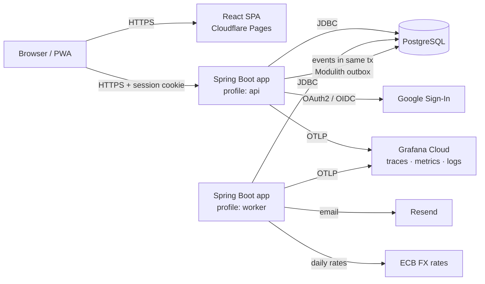

# Architecture — MoneyTrail

## Overview

A **modular monolith** in **Java 25 + Spring Boot 4**, with module boundaries enforced by
**Spring Modulith**. **PostgreSQL** is the only stateful dependency, and the frontend is a
**React + TypeScript SPA**. See [ADR-0002](adr/0002-modular-monolith.md) for why this is
not microservices.

This document describes the target design across all milestones. Features ship in the
[roadmap](roadmap.md) order: a person's income and expenses first, then groups. Receipt
QR scanning (`invoices`) and the other automation modules come later.



| Component | Responsibility |
|---|---|
| App, profile `api` | REST API (`/v1`), authentication, validation, ledger writes, event publication |
| App, profile `worker` | Event listeners and scheduled jobs: recurring transactions, CSV imports, budget alerts, FX rates, nightly ledger invariant check, idempotency key cleanup |
| App, profile `migrate` | Fly.io's release command on every deploy: applies the Flyway migrations, then exits ([ADR-0009](adr/0009-migrations-as-release-command.md)) |
| PostgreSQL | System of record, plus the sessions table, the event publication registry (outbox) and ShedLock locks. No Kafka or Redis to run or pay for |
| Frontend | Vite SPA. Talks to the API through a TypeScript client generated from the OpenAPI spec |

There is one artifact (a single jar / image) running in two roles, plus a short `migrate`
run on every deploy. Locally and at the start of production both roles can run in one
process.

## Tech stack

| Concern | Choice |
|---|---|
| Language / runtime | Java 25 (LTS), **virtual threads** enabled |
| Framework | Spring Boot 4, Spring Web MVC |
| Build | Gradle (Kotlin DSL), version catalog `gradle/libs.versions.toml` |
| Modularity | Spring Modulith (`ApplicationModules.verify()` in tests, generated module docs) |
| Persistence | Spring Data JPA (Hibernate) for aggregates. `JdbcClient` for reports and ledger hot paths |
| Migrations | Flyway. In production only the release command applies them; the other processes validate ([ADR-0009](adr/0009-migrations-as-release-command.md)) |
| Events / outbox | Spring Modulith event publication registry (JDBC). Optional Kafka externalisation later |
| Scheduling | `@Scheduled` + **ShedLock** (safe with more than one instance) |
| API contract | OpenAPI 3.1, spec-first, `openapi-generator` (Spring interfaces + TS client) |
| Errors | Spring `ProblemDetail` (RFC 9457) |
| Security | Spring Security OAuth2 Login (Google), Spring Session JDBC, CSRF via cookie token |
| Validation | Jakarta Bean Validation |
| Observability | Actuator, Micrometer, OpenTelemetry (OTLP), structured JSON logging |
| Testing | JUnit, AssertJ, Testcontainers (`@ServiceConnection`), jqwik (property-based), MockMvc, k6 |
| Code quality | Spotless (palantir-java-format), Error Prone + NullAway (JSpecify annotations) |
| Images | Spring Boot `bootBuildImage` (Paketo buildpacks), running as non-root |

### Frontend

| Concern | Choice |
|---|---|
| Build / language | Vite + React + TypeScript (strict) |
| Data fetching | TanStack Query over an `openapi-fetch` client generated from the spec |
| Routing | React Router |
| UI | Tailwind CSS + shadcn/ui, Recharts for charts |
| Forms | React Hook Form + Zod |
| Mobile | PWA (`vite-plugin-pwa`). QR scanning with the browser's `BarcodeDetector`, falling back to `@zxing/browser` |
| i18n | Portuguese and English from day one (`i18next`). Follows the browser until the person picks a language, which is remembered |
| Money display | `Intl.NumberFormat` from `amountMinor` + currency, never floating-point maths |
| Money input | Typed text (`12,50` or `12.50`) read as integer minor units, never `parseFloat`. More decimals than the currency has are refused |

## Module boundaries

Spring Modulith treats every direct subpackage of the root as an application module:

```
io.github.muzachio.moneytrail
├── ledger/      # core: accounts, journal entries, postings, balances. Exposes LedgerService only.
├── personal/    # use cases: expense / income / transfer → ledger entries
├── groups/      # groups, members, invites, splits, settlements → ledger entries
├── budgets/
├── invoices/    # ATCUD QR parsing + merchant memory
├── imports/     # CSV statement import
├── reports/     # read-side queries (spend by category, trends)
├── identity/    # users, Google login, sessions
└── shared/      # Money, idempotency, web/problem handling, config (open module)
```

Rules:
- A module exposes a public API in its root package. Everything in `internal`
  subpackages is private. `ModularityTests` fails the build on violations.
- **Only `ledger` writes to `journal_entries`, `postings` and `account_balances`.**
- Modules communicate through **calls to the public API** (synchronous, same transaction)
  or **domain events**. A module that must react to another's event without that module
  depending on it picks one of two kinds of listener ([ADR-0010](adr/0010-synchronous-listeners.md)):
  - **`@EventListener`: synchronous, in the publisher's transaction.** For state the user
    needs at once, so that it never exists without the change that caused it. It runs before
    the publisher's request answers and commits or rolls back with it, so a failure fails that
    request, which can be retried. Example: `identity` publishes `UserSignedIn` inside the
    sign-in transaction and `personal` opens the user's ledger with the default categories, so
    no user ever exists without categories. Such a listener declares
    `@Transactional(propagation = MANDATORY)`, so it refuses to run outside a transaction.
  - **`@ApplicationModuleListener`: asynchronous, after commit, through the outbox** (below).
    For work that may happen a little later and must neither slow down nor fail the request:
    budget alerts, imports, notifications. This is the default.

  Either way, listeners are idempotent: an outbox event can be delivered twice, and
  `UserSignedIn` comes with every sign-in, not only the first.
- Controllers are thin: map the request DTO → call the use case → map the response. No
  repositories in controllers.

## The ledger

### Model

Every money movement is a **journal entry** with **two or more postings**.
Amounts are signed `long` in **minor units** (cents): debit is positive, credit is
negative. The postings of an entry **must sum to zero** for each currency. In code,
money is a `Money(long minor, Currency currency)` record. `double` is never used, and
`BigDecimal` only for FX conversion and percentage splits.

Categories *are* ledger accounts of kind `EXPENSE` or `INCOME`, as in Beancount and
GnuCash. This keeps reports a plain `SUM` over postings.

Each user has one **personal ledger**, which `personal` opens the first time they sign in
(users from before it existed: their next sign-in), with the default categories and an
`Equity:Opening balances` account that the accounts' opening balances are posted against. Such an
entry records money the user already had, so an account's change over a month (the accounts list
shows this month's) leaves out every entry that posts to an `EQUITY` account. A default
category's stable key (`food`, `salary`, ...) lives in the account's `subtype`; the API sends that key and leaves the name out until the
user renames the category, so the app shows it in the user's language. Within a ledger and a
kind, active categories have different names, ignoring case (a unique index, so concurrent
requests cannot get around it).

| Account kind | Examples | Normal balance |
|---|---|---|
| `ASSET` | Checking, Savings, Cash | debit (+) |
| `LIABILITY` | Credit card | credit (−) |
| `INCOME` | Salary, Refunds | credit (−) |
| `EXPENSE` | Food, Transport | debit (+) |
| `EQUITY` | Opening balances | credit (−) |
| `GROUP_MEMBER` | Pedro @ Lisbon trip | + is owed by the group, − owes the group |

### Examples

**€12.50 lunch paid with the checking account**

| Account | Amount |
|---|---|
| Expense:Food | +1250 |
| Asset:Checking | −1250 |

**Fixing that it was €15 instead:** reverse the entry (an exact negation, dated the same day and
linked through `reverses_entry_id`), then post the corrected one, linked to the entry it replaces
through `replaces_entry_id`, in the same database transaction. Nothing is ever updated or deleted.
Because the reversal keeps the original's date, that day's and that month's sums end up as if the
mistake had never been posted.

**Group dinner, €30 paid by Pedro, split equally between Pedro, Ana and João**

| Account | Amount | Meaning |
|---|---|---|
| Member:Pedro | +3000 | paid |
| Member:Pedro | −1000 | his share |
| Member:Ana | −1000 | her share |
| Member:João | −1000 | his share |

Balances: Pedro +2000 (is owed €20), Ana −1000, João −1000.
**Ana settles €10 with Pedro:** Member:Ana +1000, Member:Pedro −1000.

**Rounding:** €10 split three ways gives 333 + 333 + 334. Remainders use the
largest-remainder method with a deterministic order (by member id), so the same input
always produces the same split and the total always matches.

**Settle-up suggestions:** greedily match the largest creditor with the largest debtor
until every balance is zero. That gives at most *n − 1* payments.

### Personal transactions

`personal` records each expense, income and transfer as one journal entry of the user's ledger,
always with an amount above zero, and reads it back as a transaction from the kinds of the accounts
it posts to:

| Transaction | Postings |
|---|---|
| Expense | +category (`EXPENSE`) −account |
| Income | −category (`INCOME`) +account |
| Transfer | +to account −from account |

Editing a transaction reverses its entry and posts the correction (above), so a transaction has a
trail of versions: its first entry, then for each edit the reversal and the correction. Only the
last version is in effect; reversing without a correction removes the transaction from the month.
New transactions cannot use archived accounts or categories. A reversal may: it only takes back what
was recorded, and refusing it would keep a mistake until the account was restored. A correction may
keep an archived account or category that the version it replaces already used, but not pick
another one. Reversals and opening balances are entries, not transactions: they appear only in a
transaction's trail and in the accounts' balances.

The transactions list asks the ledger for the entries *in effect* (neither a reversal nor reversed)
of a month, in its own terms: entries that post to given accounts, to an account of a kind (an
expense posts to an `EXPENSE` account) or to none of some kinds (a transfer posts to no category,
and nothing listed posts to `EQUITY`). Pages are newest first by `(occurred_on, id)`; ids are
UUIDv7, so within a day the last recorded comes first. The month's summary counts every matching
transaction but sums only the categories' postings, so transfers add nothing to income, spending or
net.

### Guarantees and how they are enforced

| Guarantee | Enforcement |
|---|---|
| Every entry balances | Validated in `LedgerService` **and** by deferred constraint triggers on `journal_entries` and `postings`, checked at commit (`SUM(amount) = 0` per entry and currency, at least 2 postings). jqwik property tests on top |
| History is immutable | Triggers reject `UPDATE`, `DELETE` and `TRUNCATE` on `journal_entries` and `postings`. JPA entities are `@Immutable` |
| Balances are correct under concurrency | `account_balances` is updated in the same transaction. Rows are locked first, in one `SELECT … ORDER BY account_id FOR UPDATE`, so **in ascending account id order** to avoid deadlocks |
| Balances are rebuildable | A nightly job recomputes `SUM(postings)` per account and raises an alert metric on any mismatch with `account_balances` |
| Posting currency = account currency | Check in `LedgerService`, plus a composite FK `(account_id, currency)` |
| Retries don't duplicate | Idempotency keys (below) |

## Data model (first cut)

```sql
users            (id uuid pk, email citext unique, name, avatar_url, created_at)
identities       (provider, subject, user_id fk, pk(provider, subject))
spring_session*  -- managed by Spring Session JDBC

ledgers          (id uuid pk, owner_type text check in ('USER','GROUP'), owner_id uuid,
                  unique(owner_type, owner_id))
accounts         (id uuid pk, ledger_id fk, kind text, subtype text, name, currency char(3),
                  archived_at, created_at, unique(id, currency),
                  unique(ledger_id, kind, lower(name)) where active EXPENSE/INCOME)
journal_entries  (id uuid pk, ledger_id fk, occurred_on date, description, merchant_tax_id,
                  reverses_entry_id fk null unique, replaces_entry_id fk null unique,
                  created_by fk users, created_at)
postings         (id bigint identity pk, entry_id fk, account_id, currency,
                  amount_minor bigint check (amount_minor <> 0),
                  fk(account_id, currency) → accounts(id, currency))
account_balances (account_id pk fk, balance_minor bigint, version bigint, updated_at)

groups           (id uuid pk, name, currency char(3), ledger_id fk, created_by, created_at)
group_members    (group_id, user_id, account_id fk accounts, role, joined_at, pk(group_id, user_id))
group_invites    (token_hash pk, group_id, expires_at, created_by)
expense_splits   (entry_id fk, user_id, method text, input_value numeric, share_minor bigint)

budgets          (id, user_id, account_id (expense category), month date, limit_minor bigint)
recurring_rules  (id, user_id, template jsonb, rrule text, next_run_on date)
merchants        (user_id, tax_id, display_name, default_account_id, pk(user_id, tax_id))

idempotency_keys (user_id fk, key, request_hash bytea, response_status, response_headers jsonb,
                  response_body bytea, created_at, pk(user_id, key))
audit_log        (id bigserial, actor_id, action, target_type, target_id, data jsonb, at)
event_publication -- managed by Spring Modulith (outbox)
shedlock          -- managed by ShedLock
```

UUIDs are **v7** (time-ordered, index-friendly), generated in the application.

## API

- REST, JSON, versioned under `/v1`, **spec-first** in `api/openapi.yaml` ([ADR-0006](adr/0006-spec-first-openapi.md)).
- Money in JSON is `{ "amountMinor": 1250, "currency": "EUR" }`. No floats on the wire either:
  a fraction such as `12.5` in an integer property is refused with `400`, never rounded.
- Days such as *today* and *this month* follow Europe/Lisbon until users can choose a time zone.
- Errors are **RFC 9457** `ProblemDetail` with a stable `code` property.
- Lists use **cursor pagination** (keyset on `(occurred_on, id)`), never `OFFSET`: the next page
  starts after the last row of the previous one, which an index reads directly however deep the page
  is, and a row added while paging neither repeats nor hides another. The cursor is opaque to
  clients.
- Every money-moving `POST` **requires an `Idempotency-Key` header**.

Main resources:

```
GET    /v1/me
GET    /oauth2/authorization/google · POST /logout          (Spring Security)

GET|POST         /v1/accounts           PATCH /v1/accounts/{id} (rename/archive/restore only)
GET|POST         /v1/categories         PATCH /v1/categories/{id} (rename/archive only)
GET|POST         /v1/transactions       GET /v1/transactions/{id}
POST             /v1/transactions/{id}/reverse
GET              /v1/reports/spending?from=&to=&groupBy=category|month

GET|POST         /v1/groups             POST /v1/groups/{id}/invites
POST             /v1/invites/{token}/accept
GET|POST         /v1/groups/{id}/expenses
GET              /v1/groups/{id}/balances
GET              /v1/groups/{id}/settle-up      (suggestions)
POST             /v1/groups/{id}/settlements

POST             /v1/invoices/parse     (raw QR string → prefilled transaction draft)
POST             /v1/imports            (CSV upload → 202 + import id) · GET /v1/imports/{id}
GET|POST|DELETE  /v1/budgets
```

### Idempotency flow

Implemented once in `shared.idempotency`. An endpoint opts in by declaring the
`Idempotency-Key` header parameter in the spec; every controller method that takes it is
wrapped by a method interceptor (a Spring AOP proxy, as for `@Transactional`), which runs
around the controller in **one transaction**:

1. `pg_try_advisory_xact_lock` on the user and key, without waiting. Taken by a request
   still running → `409 Conflict`.
2. A stored response for the key: a request with another fingerprint (SHA-256 of the method,
   path and body) → `422`; the same request → replay the stored status, headers and body.
3. Otherwise the controller runs; its services join the transaction. Its response is
   serialized, stored and committed **with the business writes**, before Spring MVC sends a
   byte of it, and the client gets exactly the stored bytes.
4. The worker deletes keys older than 24 h once a day (`@Scheduled` + ShedLock).

A request that throws, or whose commit fails, leaves neither writes nor a key behind and can
be retried with the same key. A `HandlerInterceptor` could not do this: it runs before and
after the handler, not around it, so it can neither hold one transaction over the handler nor
commit before the response is written. The advisory lock, released by commit, rollback or a
dropped connection, replaces an `IN_PROGRESS` row that a crash could leave behind.

The frontend creates the key with `crypto.randomUUID()` once per user action and sends the same
key when that action is retried: TanStack Query's retries, a second tap, or Save pressed again
after a network error with the same input (`useMoneyMutation`).

### Async work and the outbox

Domain events (`ExpenseRecorded`, `GroupExpenseAdded`, `ImportUploaded`, ...) are
published with Spring's `ApplicationEventPublisher` inside the business transaction.
Spring Modulith writes them to `event_publication` **in that same transaction**: this is
the transactional outbox pattern ([ADR-0005](adr/0005-events-and-outbox.md)). Listeners
run after commit. Publications that fail stay incomplete, get resubmitted, and are
monitored. Each listener is idempotent.

The outbox is the default, not the rule for every event. Its listeners run after the
request has answered, so whatever they create may not exist yet when the client sends its
next request. When the user needs the result at once, the listener is a plain
`@EventListener` instead and joins the publisher's transaction ("Module boundaries" above).
The first such case: on sign-in, `personal` opens the user's ledger with the default
categories, because the app lists the categories right after sign-in. Opening it after commit
would leave a short window, or after a failure a lasting one, with a user and no categories.
It also has to be safe when two sign-ins of the same user overlap: `ledgers` is unique per
owner, and the ledger is inserted with `ON CONFLICT DO NOTHING`, so the second insert waits for
the first transaction and then does nothing instead of failing the sign-in.

## Security
- Google login through Spring Security's OAuth2 client (authorization code + PKCE, `state`, `nonce`).
- Server-side sessions in Postgres (Spring Session JDBC). Cookie `__Host-SESSION`:
  `HttpOnly; Secure; SameSite=Lax`.
- Frontend `app.<domain>` and API `api.<domain>` on the same site. CORS allowlist with
  credentials. CSRF protection with `CookieCsrfTokenRepository`: the SPA sends `X-XSRF-TOKEN`.
- Authorization in every use case: a user only reaches ledgers they own or groups they belong to.
  Integration tests cover cross-tenant access explicitly.
- Rate limiting per user and IP (Bucket4j, in memory, one instance).
- Supply chain: Renovate, OWASP dependency-check or Trivy image scan in CI, non-root image.

## Observability
- JSON logs (Spring Boot structured logging, ECS format) with `traceId` and `userId`.
  No amounts or personal data in logs.
- Micrometer Observation → OpenTelemetry traces: HTTP, JDBC, event listeners, scheduled jobs.
- Metrics: RED per endpoint, listener and job durations and failures, incomplete event
  publications, ledger invariant check result.
- Everything exported over OTLP to Grafana Cloud's free tier. Locally the stack runs in
  docker compose (`--profile observability`, Grafana LGTM image).

## Testing strategy

| Level | Tooling | Covers |
|---|---|---|
| Unit | JUnit + AssertJ | Split math, rounding, settle-up algorithm, QR parser, validation |
| Property-based | jqwik | Any random sequence of operations keeps every entry balanced and balances equal to `SUM(postings)` |
| Architecture | Spring Modulith `verify()` | No module reaches into another module's internals |
| Module integration | `@ApplicationModuleTest` + Testcontainers Postgres | Each module in isolation, plus the events it publishes (`Scenario` API) |
| Persistence | Testcontainers | Triggers, constraints, idempotency, cross-tenant authorization |
| Concurrency | `ExecutorService` against a real DB | N parallel expenses on the same account → final balance exact, no deadlocks |
| API / E2E | MockMvc / `RestTestClient` | Full flows: sign in → create account → expense → group split → settle |
| Frontend | Vitest + Testing Library, Playwright for one smoke flow | |
| Load | k6 | p95 targets from the product spec |

## Environments

| Env | How |
|---|---|
| Local | `./gradlew bootRun` (Spring Boot docker-compose support starts Postgres automatically) + `npm run dev` in `frontend/` |
| Production | Fly.io (api + worker roles), Neon Postgres, Cloudflare Pages, custom domain ([ADR-0008](adr/0008-deployment.md)) |
