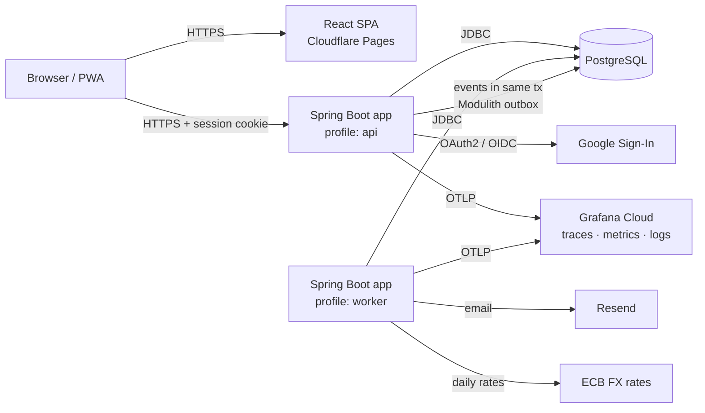

# Architecture — MoneyTrail

## Overview

A **modular monolith** in **Java 25 + Spring Boot 4**, with module boundaries enforced by
**Spring Modulith**. **PostgreSQL** is the only stateful dependency, and the frontend is a
**React + TypeScript SPA**. See [ADR-0002](adr/0002-modular-monolith.md) for why this is
not microservices.

This document describes the target design across all milestones. Features ship in the
[roadmap](roadmap.md) order: a person's income and expenses first, then groups. Receipt
QR scanning (`invoices`) and the other automation modules come later.



| Component | Responsibility |
|---|---|
| App, profile `api` | REST API (`/v1`), authentication, validation, ledger writes, event publication, and the listeners of the events it publishes (below) |
| App, profile `worker` | Scheduled jobs: recurring transactions, CSV imports, budget alerts, FX rates, nightly ledger invariant check, idempotency key cleanup, resubmitting event publications |
| App, profile `migrate` | Fly.io's release command on every deploy: applies the Flyway migrations, then exits ([ADR-0009](adr/0009-migrations-as-release-command.md)) |
| PostgreSQL | System of record, plus the sessions table, the event publication registry (outbox) and ShedLock locks. No Kafka or Redis to run or pay for |
| Frontend | Vite SPA. Talks to the API through a TypeScript client generated from the OpenAPI spec |

There is one artifact (a single jar / image) running in two roles, plus a short `migrate`
run on every deploy. Locally and at the start of production both roles can run in one
process.

Whether a process runs the scheduled jobs is one setting, `moneytrail.jobs.enabled`, not its
profile. The worker turns it on. In production the `worker` group has no machine yet: a second
machine for one query a day would double the bill. Until it has one, the `api` process turns
the setting on too (`backend/fly.toml`). The `migrate` run never does: it must exit once the
migrations are applied. ShedLock keeps each run of a job to one process, so the jobs move to a
worker by giving it a machine and then turning the setting off in the `api`.

## Tech stack

| Concern | Choice |
|---|---|
| Language / runtime | Java 25 (LTS), **virtual threads** enabled |
| Framework | Spring Boot 4, Spring Web MVC |
| Build | Gradle (Kotlin DSL), version catalog `gradle/libs.versions.toml` |
| Modularity | Spring Modulith (`ApplicationModules.verify()` in tests, generated module docs) |
| Persistence | Spring Data JPA (Hibernate) for aggregates. `JdbcClient` for reports and ledger hot paths |
| Migrations | Flyway. In production only the release command applies them; the other processes validate ([ADR-0009](adr/0009-migrations-as-release-command.md)) |
| Events / outbox | Spring Modulith event publication registry (JDBC). Optional Kafka externalisation later |
| Scheduling | `@Scheduled` + **ShedLock** (safe with more than one instance) |
| API contract | OpenAPI 3.1, spec-first, `openapi-generator` (Spring interfaces + TS client) |
| Errors | Spring `ProblemDetail` (RFC 9457) |
| Security | Spring Security OAuth2 Login (Google), Spring Session JDBC, CSRF via cookie token |
| Validation | Jakarta Bean Validation |
| Observability | Actuator, Micrometer, OpenTelemetry (OTLP), structured JSON logging |
| Testing | JUnit, AssertJ, Testcontainers (`@ServiceConnection`), jqwik (property-based), MockMvc, k6 |
| Code quality | Spotless (palantir-java-format), Error Prone + NullAway (JSpecify annotations) |
| Images | Spring Boot `bootBuildImage` (Paketo buildpacks), running as non-root |

### Frontend

| Concern | Choice |
|---|---|
| Build / language | Vite + React + TypeScript (strict) |
| Data fetching | TanStack Query over an `openapi-fetch` client generated from the spec |
| Routing | React Router |
| UI | Tailwind CSS + shadcn/ui, Recharts for charts (in a chunk of its own, loaded only where a chart shows). Every chart has a table with the same numbers |
| Layout | Below Tailwind's `sm` (40rem) the phone layout: bottom tabs with the new-transaction button in the centre, and shorter pages where the design canvas has them |
| Forms | React Hook Form + Zod |
| Mobile | PWA (`vite-plugin-pwa`), installable from inside the app (the browser's install dialog, or the "Add to Home Screen" steps on an iPhone). The service worker precaches only the app shell the build produced and has no runtime caching, so API responses (financial data) always come from the network. A new deploy is offered with an Update bar, never forced with a reload, and starts by itself the next time the app opens. Icons are made from `public/favicon.svg` (`npm run generate:icons`) and committed. QR scanning with the browser's `BarcodeDetector`, falling back to `@zxing/browser` |
| i18n | Portuguese and English from day one (`i18next`). Follows the browser until the person picks a language, which is remembered |
| Money display | `Intl.NumberFormat` from `amountMinor` + currency, never floating-point maths. Shares of an amount ("85% of income") are whole percentages worked out with `BigInt`, rounded half up |
| Money input | Typed text (`12,50` or `12.50`) read as integer minor units, never `parseFloat`. More decimals than the currency has are refused |

## Module boundaries

Spring Modulith treats every direct subpackage of the root as an application module:

```
io.github.muzachio.moneytrail
├── ledger/      # core: accounts, journal entries, postings, balances. Exposes LedgerService only.
├── personal/    # use cases: expense / income / transfer → ledger entries; a member's share of groups (ADR-0015)
├── groups/      # groups, members, invites, splits, settlements → ledger entries
├── activity/    # each group's feed, from the events of groups (ADR-0014)
├── budgets/
├── invoices/    # ATCUD QR parsing + merchant memory
├── imports/     # CSV statement import
├── reports/     # read-side queries (spend by category, trends)
├── identity/    # users, Google login, sessions
└── shared/      # Money, idempotency, web/problem handling, config (open module)
```

Rules:
- A module exposes a public API in its root package. Everything in `internal`
  subpackages is private. `ModularityTests` fails the build on violations.
- **Only `ledger` writes to `journal_entries`, `postings` and `account_balances`.** `reports`,
  the ledger's read side, reads them with SQL and never writes them
  ([ADR-0011](adr/0011-reports-read-the-ledger-tables.md)).
- Modules communicate through **calls to the public API** (synchronous, same transaction)
  or **domain events**. A module that must react to another's event without that module
  depending on it picks one of two kinds of listener ([ADR-0010](adr/0010-synchronous-listeners.md)):
  - **`@EventListener`: synchronous, in the publisher's transaction.** For state the user
    needs at once, so that it never exists without the change that caused it. It runs before
    the publisher's request answers and commits or rolls back with it, so a failure fails that
    request, which can be retried. Example: `identity` publishes `UserSignedIn` inside the
    sign-in transaction and `personal` opens the user's ledger with the default categories, so
    no user ever exists without categories. Such a listener declares
    `@Transactional(propagation = MANDATORY)`, so it refuses to run outside a transaction.
  - **`@ApplicationModuleListener`: asynchronous, after commit, through the outbox** (below).
    For work that may happen a little later and must neither slow down nor fail the request:
    the activity feed of groups, a member's share of a group in their ledger, budget alerts,
    imports, notifications. This is the default. It
    runs in the process that published the event, in a thread of its own.

  Either way, listeners are idempotent: an outbox event can be delivered twice, and
  `UserSignedIn` comes with every sign-in, not only the first.
- Controllers are thin: map the request DTO → call the use case → map the response. No
  repositories in controllers.

## The ledger

### Model

Every money movement is a **journal entry** with **two or more postings**.
Amounts are signed `long` in **minor units** (cents): debit is positive, credit is
negative. The postings of an entry **must sum to zero** for each currency. In code,
money is a `Money(long minor, Currency currency)` record. `double` is never used, and
`BigDecimal` only for FX conversion: splits, percentages included, use whole numbers
([ADR-0012](adr/0012-groups-on-the-ledger.md)).

Categories *are* ledger accounts of kind `EXPENSE` or `INCOME`, as in Beancount and
GnuCash. This keeps reports a plain `SUM` over postings.

Each user has one **personal ledger**, which `personal` opens the first time they sign in
(users from before it existed: their next sign-in), with the default categories and an
`Equity:Opening balances` account that the accounts' opening balances are posted against. Such an
entry records money the user already had, so an account's change over a month (the accounts list
shows this month's) leaves out every entry that posts to an `EQUITY` account. Which default a
category is (`food`, `salary`, ...) lives in the account's `subtype` and never changes. What a
category is called is either a **known name**, a key from the app's list (`CategoryKey` in the
API: the defaults' names and about thirty more), or a name the user typed. A known name is kept by
`personal` in its own `category_keys` table and shown in each person's language; the app sends the
key when the user types a name from the list in the language it is showing, so "Ginásio" typed in
Portuguese reads "Gym" in English. The account keeps the known name's English form, so the rule
that active categories of a ledger and kind have different names, ignoring case (a unique index,
so concurrent requests cannot get around it), sees "Alimentação" and "Food" as the same name. A
default category's icon never changes; the icon a user picks for a category of their own, from a
fixed list (`CategoryIcon`), is kept by `personal` in `category_icons`. Neither table changes the
ledger: its accounts know nothing about how the app names or draws a category.

| Account kind | Examples | Normal balance |
|---|---|---|
| `ASSET` | Checking, Savings, Cash, Investments | debit (+) |
| `LIABILITY` | Credit card | credit (−) |
| `INCOME` | Salary, Refunds | credit (−) |
| `EXPENSE` | Food, Transport | debit (+) |
| `EQUITY` | Opening balances | credit (−) |
| `GROUP_MEMBER` | Pedro @ Lisbon trip | + is owed by the group, − owes the group |

A person's accounts keep their type (checking, savings, cash, investment, credit card) in the
account's `subtype`. Investing is not spending: buying units of a fund trades one asset for
another, so money moved into an investment account is a transfer, and the reports never count it.
Its balance is what went in minus what came out; holdings and market value are out of scope. One
asset type can become another (a savings account used for investing becomes an investment account),
which changes the `subtype` and nothing else, but a credit card keeps its type: the same balance
would then mean money owed instead of money had.

### Examples

**€12.50 lunch paid with the checking account**

| Account | Amount |
|---|---|
| Expense:Food | +1250 |
| Asset:Checking | −1250 |

**Fixing that it was €15 instead:** reverse the entry (an exact negation, dated the same day and
linked through `reverses_entry_id`), then post the corrected one, linked to the entry it replaces
through `replaces_entry_id`, in the same database transaction. Nothing is ever updated or deleted.
Because the reversal keeps the original's date, that day's and that month's sums end up as if the
mistake had never been posted.

**Group dinner, €30 paid by Pedro, split equally between Pedro, Ana and João**

| Account | Amount | Meaning |
|---|---|---|
| Member:Pedro | +3000 | paid |
| Member:Pedro | −1000 | his share |
| Member:Ana | −1000 | her share |
| Member:João | −1000 | his share |

Balances: Pedro +2000 (is owed €20), Ana −1000, João −1000.
**Ana settles €10 with Pedro:** Member:Ana +1000, Member:Pedro −1000.

**Rounding:** €10 split three ways gives 334 + 333 + 333. The cent left over goes to the largest
remainder; here all three are equal, so it goes to the member whose id comes first as text. Equal
splits, shares and percentages are all whole-number weights divided this way, so the same input
always produces the same split and the shares always add up to the total
([ADR-0012](adr/0012-groups-on-the-ledger.md)).

**Settle-up suggestions:** the member who owes the most pays the member who is owed the most,
until every balance is zero. That gives at most *n − 1* payments, though not always the fewest.

### Personal transactions

`personal` records each expense, income and transfer as one journal entry of the user's ledger,
always with an amount above zero, and reads it back as a transaction from the kinds of the accounts
it posts to:

| Transaction | Postings |
|---|---|
| Expense | +category (`EXPENSE`) −account |
| Income | −category (`INCOME`) +account |
| Transfer | +to account −from account |

Editing a transaction reverses its entry and posts the correction (above), so a transaction has a
trail of versions: its first entry, then for each edit the reversal and the correction. Only the
last version is in effect; reversing without a correction removes the transaction from the month.
New transactions cannot use archived accounts or categories. A reversal may: it only takes back what
was recorded, and refusing it would keep a mistake until the account was restored. A correction may
keep an archived account or category that the version it replaces already used, but not pick
another one. Reversals and opening balances are entries, not transactions: they appear only in a
transaction's trail and in the accounts' balances.

The transactions list asks the ledger for the entries *in effect* (neither a reversal nor reversed)
of a month, in its own terms: entries that post to given accounts, to an account of a kind (an
expense posts to an `EXPENSE` account) or to none of some kinds (a transfer posts to no category,
and nothing listed posts to `EQUITY`). Pages are newest first by `(occurred_on, id)`; ids are
UUIDv7, so within a day the last recorded comes first. The month's summary counts every matching
transaction but sums only the categories' postings, so transfers add nothing to income, spending or
net.

### Groups

Each group has its own ledger, with one `GROUP_MEMBER` account per member and one currency, fixed
when the group is created ([ADR-0012](adr/0012-groups-on-the-ledger.md)). `groups` records:

| Movement | Postings |
|---|---|
| Expense of `T`, paid by P | P `+T`; each person in the split `−share` |
| Payment of `X` from A to B (a settlement) | A `+X`, B `−X` |

The payer's account can appear twice in an expense (`+T` and their own `−share`), so the entry
shows both what they paid and their part; a share of zero gets no posting. Every entry adds up to
zero and posts only to the group's own accounts, so the member balances of a group always add up
to zero. The split (method, and each person's input and share) is kept by `groups` in
`expense_splits`. Any member can edit or reverse an expense or a payment, through a reversal and a
correction as for personal transactions, and the trail shows who made each version. A member
leaves only with a balance of zero, and an expense that moves the balance of someone who left can
no longer be edited or reversed. Who pays and who is in a split must be members now: anyone else
answers like an unknown member (`member_not_found`).

Each expense also says what it was for: one of the eight default expense categories' keys
(`housing`, `food`, `transport`, `bills`, `shopping`, `leisure`, `health`, `other`), so the app
shows it with the same name and icon as a person's own category. It is a label that `groups` keeps
in `expense_categories`, one row per version like the split, and not a ledger account: an
`EXPENSE` account in a group's ledger would break the rule that its entries post only to members'
accounts, which is what keeps their balances adding up to zero. `groups` writes the eight keys out
itself (`ExpenseCategory`, in its API because the expense events carry it) rather than reading
`personal`'s categories, which it must not depend on. An edit can change the category, and the
trail shows each version's.

A settlement posts exactly what an expense that one member paid for one other member posts, so the
postings cannot tell the two apart: an expense has its split, and a settlement has a row of its own
in `settlements`. Who paid and who was paid are read back from the postings, as who paid an expense
is.

An expense's or a settlement's id is its entry's, and each edit gives it a new one, as for personal
transactions. The group's list asks the ledger for the entries in effect of the group's ledger,
newest first by `(occurred_on, id)`, with no period, and shows each as an expense or a settlement.
Each change publishes an event in its transaction (`GroupExpenseAdded`, `GroupExpenseEdited`,
`GroupExpenseReversed`, `SettlementRecorded`, `SettlementEdited`, `SettlementReversed`), with what
the activity feed shows and no email.

A group's balances are its members' accounts in `account_balances`, read through `LedgerService`;
the settle-up suggestions are worked out from them on each request and never stored
([ADR-0012](adr/0012-groups-on-the-ledger.md)). The list of a user's groups reads the user's
balance in each of them with one `balancesOf` call.

Only members reach a group: anyone else, someone who left included, gets `404`. Members see each
other by name and photo, through `identity`'s `UserProfiles`, never by email. Two checks must not
race with a posting: archiving locks the group's row `FOR UPDATE` while it checks that every balance
is zero, and leaving locks the member's row `FOR UPDATE` while it checks theirs. An expense or a
payment locks the group's row and its members' rows `FOR SHARE` before posting, so each waits for
the other and neither check reads a balance that is about to change.

People join through an invite link that holds a random token. The database keeps only its
SHA-256, and the token travels in the link's fragment and in request bodies, never in a URL the
server sees. A link lets someone into a group, never into the app
([ADR-0013](adr/0013-group-invites.md)).

### A member's share in their own ledger

Each member can turn on, group by group, the mirror of the group in their personal ledger
([ADR-0015](adr/0015-group-shares-in-the-personal-ledger.md)). Turning it on opens a `GROUP` account
in their ledger (an `ASSET`, subtype `group`) whose balance is always their balance in the group, and
gives it that balance against `Equity:Opening balances`. From then on, a listener in `personal`
records each group entry they take part in, read from their postings in it (what they paid, `P`, and
their share or what they received, `S`):

| Group entry | Personal entry |
|---|---|
| Expense | their category with the expense's key `+S`, the paying account `−P`, the group's account `+(P − S)` |
| Settlement | the paying account `−P` or `+S`, against the group's account: a transfer |

Edits and reversals in the group replace or reverse the personal entry; earlier entries are only in
the opening balance, and a correction of one of them adjusts that balance against equity. The
mirror's entries are transactions with a link to their group; the personal endpoints refuse to edit
them or to use the group's account, except for the account the money came from, which the member can
change on each one. Shares are spending, so reports include them; in the income's split (#125) the
group's account is neither savings nor investment.

### Reports

The dashboard's reports (`GET /v1/reports/spending`) are one query in `reports`: the sum of the
postings to each category of the user's ledger in each calendar month of the period. Spending is
what the `EXPENSE` categories were debited, income what the `INCOME` ones were credited. The plain
sum follows the rules above with no special case: a transfer or an opening balance posts to no
category, and a reversal cancels its entry within the same day, so a reversed transaction adds
nothing and an edited one adds only its correction. By category, the months are added up and the
categories with spending come largest first; by month, every month of the period is there, with
zeros when nothing moved. A period covers at most 24 calendar months.

Where the income went (`GET /v1/reports/income-allocation`, #125) splits it into spent, invested
and saved, and adds a second query: how much each of the user's own accounts changed in the
period, leaving out entries that post to `EQUITY` (opening balances), as the accounts page counts
a month's change. `personal` says what each account is for (`PersonalLedgerQueries.accountUses`:
everyday, savings or investment), so `reports` never reads its account-type keys. Invested is the
investment accounts' change, negative when money came out of them; saved is the rest of the
income, so the three parts always add up to it, and the savings accounts' change is reported as
the part of saved they account for. Since every other entry of a personal ledger posts only to the
user's accounts and categories and balances to zero, the accounts' changes add up to income less
spending, so saved is also what the checking, cash and savings accounts gained less what credit
cards' debt grew: saved plus invested is what was kept of the income.

### Guarantees and how they are enforced

| Guarantee | Enforcement |
|---|---|
| Every entry balances | Validated in `LedgerService` **and** by deferred constraint triggers on `journal_entries` and `postings`, checked at commit (`SUM(amount) = 0` per entry and currency, at least 2 postings). jqwik property tests on top |
| History is immutable | Triggers reject `UPDATE`, `DELETE` and `TRUNCATE` on `journal_entries` and `postings`. JPA entities are `@Immutable` |
| Balances are correct under concurrency | `account_balances` is updated in the same transaction. Rows are locked first, in one `SELECT … ORDER BY account_id FOR UPDATE`, so **in ascending account id order** to avoid deadlocks |
| Balances are rebuildable | A nightly job recomputes `SUM(postings)` per account and raises an alert metric on any mismatch with `account_balances` |
| Posting currency = account currency | Check in `LedgerService`, plus a composite FK `(account_id, currency)` |
| Retries don't duplicate | Idempotency keys (below) |

## Data model (first cut)

```sql
users            (id uuid pk, email citext unique, name, avatar_url, created_at)
identities       (provider, subject, user_id fk, pk(provider, subject))
spring_session*  -- managed by Spring Session JDBC

ledgers          (id uuid pk, owner_type text check in ('USER','GROUP'), owner_id uuid,
                  unique(owner_type, owner_id))
accounts         (id uuid pk, ledger_id fk, kind text, subtype text, name, currency char(3),
                  archived_at, created_at, unique(id, currency),
                  unique(ledger_id, kind, lower(name)) where active EXPENSE/INCOME)
journal_entries  (id uuid pk, ledger_id fk, occurred_on date, description, merchant_tax_id,
                  reverses_entry_id fk null unique, replaces_entry_id fk null unique,
                  created_by fk users, created_at)
postings         (id bigint identity pk, entry_id fk, account_id, currency,
                  amount_minor bigint check (amount_minor <> 0),
                  fk(account_id, currency) → accounts(id, currency))
account_balances (account_id pk fk, balance_minor bigint, version bigint, updated_at)
category_icons   (category_id pk fk accounts, icon text check in CategoryIcon)  -- personal's
category_keys    (category_id pk fk accounts, key text check in CategoryKey)    -- personal's

groups           (id uuid pk, name, currency char(3), ledger_id fk, created_by, created_at,
                  archived_at)
group_members    (group_id, user_id, account_id fk accounts, joined_at, left_at,
                  pk(group_id, user_id))
group_invites    (id uuid pk, group_id, token_hash bytea unique, created_by, created_at,
                  expires_at, revoked_at)
expense_splits   (entry_id fk, user_id, method text, input_value bigint, share_minor bigint,
                  pk(entry_id, user_id))  -- input_value: 1, the shares, basis points or the amount
expense_categories (entry_id pk fk journal_entries, category text check in the 8 default expense keys)
settlements      (entry_id pk fk journal_entries)  -- which entries of a group are settlements
activity_items   (id uuid pk, group_id fk, kind, actor_id fk users, occurred_at, subject_id,
                  what the item shows: group_name, description, category, amount_minor, currency,
                  previous_description, previous_category, previous_amount_minor, paid_by,
                  from_user_id, to_user_id, occurred_on;
                  unique(group_id, kind, subject_id, occurred_at))  -- activity's
group_mirrors    (user_id, group_id, member_account_id fk accounts, account_id fk accounts unique,
                  category_id fk accounts, payment_account_id fk accounts, enabled,
                  pk(user_id, group_id))  -- personal's: a member's mirror of a group (ADR-0015)
group_mirror_entries (group_entry_id fk journal_entries, user_id, group_id, type,
                  personal_entry_id fk journal_entries unique, before_mirror,
                  pk(group_entry_id, user_id))  -- personal's: each group entry handled once per member

budgets          (id, user_id, account_id (expense category), month date, limit_minor bigint)
recurring_rules  (id, user_id, template jsonb, rrule text, next_run_on date)
merchants        (user_id, tax_id, display_name, default_account_id, pk(user_id, tax_id))

idempotency_keys (user_id fk, key, request_hash bytea, response_status, response_headers jsonb,
                  response_body bytea, created_at, pk(user_id, key))
audit_log        (id bigserial, actor_id, action, target_type, target_id, data jsonb, at)
event_publication -- Spring Modulith's outbox, created by Flyway (V19) with Spring Modulith 2.2's columns
shedlock          -- managed by ShedLock
```

UUIDs are **v7** (time-ordered, index-friendly), generated in the application.

## API

- REST, JSON, versioned under `/v1`, **spec-first** in `api/openapi.yaml` ([ADR-0006](adr/0006-spec-first-openapi.md)).
- Money in JSON is `{ "amountMinor": 1250, "currency": "EUR" }`. No floats on the wire either:
  a fraction such as `12.5` in an integer property is refused with `400`, never rounded.
- Days such as *today* and *this month* follow Europe/Lisbon until users can choose a time zone.
- Errors are **RFC 9457** `ProblemDetail` with a stable `code` property.
- Lists use **cursor pagination** (keyset on `(occurred_on, id)`), never `OFFSET`: the next page
  starts after the last row of the previous one, which an index reads directly however deep the page
  is, and a row added while paging neither repeats nor hides another. The cursor is opaque to
  clients.
- Every money-moving `POST` **requires an `Idempotency-Key` header**.

Main resources:

```
GET    /v1/me
GET    /oauth2/authorization/google · POST /logout          (Spring Security)

GET|POST         /v1/accounts           PATCH /v1/accounts/{id} (rename/retype/archive/restore only)
GET|POST         /v1/categories         PATCH /v1/categories/{id} (rename/archive only)
GET|POST         /v1/transactions       GET /v1/transactions/{id}
POST             /v1/transactions/{id}/reverse
POST             /v1/transactions/{id}/account   (a group share's paying account)
GET              /v1/reports/spending?from=&to=&groupBy=category|month
GET              /v1/reports/income-allocation?from=&to=

GET|POST         /v1/groups             GET|PATCH /v1/groups/{id}   POST /v1/groups/{id}/leave
GET|POST         /v1/groups/{id}/invites        DELETE /v1/groups/{id}/invites/{inviteId}
POST             /v1/invites/lookup · POST /v1/invites/accept   (token in the body, never the URL)
GET|POST         /v1/groups/{id}/expenses       (the list: expenses and settlements)
GET              /v1/groups/{id}/expenses/{expenseId}
POST             /v1/groups/{id}/expenses/{expenseId}/reverse
GET              /v1/groups/{id}/balances
GET              /v1/groups/{id}/settle-up      (suggestions)
POST             /v1/groups/{id}/settlements    GET /v1/groups/{id}/settlements/{settlementId}
POST             /v1/groups/{id}/settlements/{settlementId}/reverse
GET              /v1/groups/{id}/activity       (the feed, newest first)
GET|PUT|DELETE   /v1/groups/{id}/mirror         (the member's share in their own ledger)

POST             /v1/invoices/parse     (raw QR string → prefilled transaction draft)
POST             /v1/imports            (CSV upload → 202 + import id) · GET /v1/imports/{id}
GET|POST|DELETE  /v1/budgets
```

### Idempotency flow

Implemented once in `shared.idempotency`. An endpoint opts in by declaring the
`Idempotency-Key` header parameter in the spec; every controller method that takes it is
wrapped by a method interceptor (a Spring AOP proxy, as for `@Transactional`), which runs
around the controller in **one transaction**:

1. `pg_try_advisory_xact_lock` on the user and key, without waiting. Taken by a request
   still running → `409 Conflict`.
2. A stored response for the key: a request with another fingerprint (SHA-256 of the method,
   path and body) → `422`; the same request → replay the stored status, headers and body.
3. Otherwise the controller runs; its services join the transaction. Its response is
   serialized, stored and committed **with the business writes**, before Spring MVC sends a
   byte of it, and the client gets exactly the stored bytes.
4. Every day at 03:00 UTC a scheduled job deletes the keys older than 24 h (`@Scheduled` +
   ShedLock), in the process that runs the jobs: for now the `api` in production.

A request that throws, or whose commit fails, leaves neither writes nor a key behind and can
be retried with the same key. A `HandlerInterceptor` could not do this: it runs before and
after the handler, not around it, so it can neither hold one transaction over the handler nor
commit before the response is written. The advisory lock, released by commit, rollback or a
dropped connection, replaces an `IN_PROGRESS` row that a crash could leave behind.

The frontend creates the key with `crypto.randomUUID()` once per user action and sends the same
key when that action is retried: TanStack Query's retries, a second tap, or Save pressed again
after a network error with the same input (`useMoneyMutation`).

The transaction dialog (new or edit) and the reverse confirmation go further: they keep one key for
as long as they are open, whatever the person changes between attempts. If an attempt was recorded
but its answer was lost, the next one cannot record the movement a second time: with the same input
it gets the stored answer, and with a changed one `idempotency_key_reused`, which the dialog shows
as "already saved" before it refreshes the list. An attempt that failed stored nothing, so the
same key still works for the corrected input.

### Async work and the outbox

Domain events (`ExpenseRecorded`, `GroupExpenseAdded`, `ImportUploaded`, ...) are
published with Spring's `ApplicationEventPublisher` inside the business transaction.
Spring Modulith writes them to `event_publication` **in that same transaction**: this is
the transactional outbox pattern ([ADR-0005](adr/0005-events-and-outbox.md)). Listeners
run after commit, in the process that published the event, and each listener is idempotent.
A completed publication is deleted, so `event_publication` holds only what is still to be
delivered ([ADR-0014](adr/0014-activity-feed-through-the-outbox.md)).

A listener that throws leaves its publication failed; one a process stopped in the middle of
stays published or processing. At the top of every hour, where the scheduled jobs run, one job
(`shared.events`, ShedLock) counts the publications not completed after 10 minutes, marks the
stale ones failed and resubmits every failed one. Spring Modulith's own resubmission on restart
and its staleness check stay off: the check would query the database on a timer of its own and
wake Neon. The gauge `moneytrail.event.publications.incomplete` reports what the last run found,
from memory.

The first listener through the outbox is the activity feed: `activity` turns each event of
`groups` (a group created, a member who joined or left, an expense or a payment recorded,
edited or reversed) into a row of `activity_items`, which keeps what the feed shows as it was
then. `groups` knows nothing of it. The second is the mirror of a group in a member's ledger
(ADR-0015): `personal` turns the same events into entries of each member's ledger who turned it on,
keeping one row per group entry and member so a duplicate or late delivery records nothing twice.

The outbox is the default, not the rule for every event. Its listeners run after the
request has answered, so whatever they create may not exist yet when the client sends its
next request. When the user needs the result at once, the listener is a plain
`@EventListener` instead and joins the publisher's transaction ("Module boundaries" above).
The first such case: on sign-in, `personal` opens the user's ledger with the default
categories, because the app lists the categories right after sign-in. Opening it after commit
would leave a short window, or after a failure a lasting one, with a user and no categories.
It also has to be safe when two sign-ins of the same user overlap: `ledgers` is unique per
owner, and the ledger is inserted with `ON CONFLICT DO NOTHING`, so the second insert waits for
the first transaction and then does nothing instead of failing the sign-in.

## Security
- Google login through Spring Security's OAuth2 client (authorization code + PKCE, `state`, `nonce`).
- Production is invite-only: an allowlist of verified emails in a Fly secret, checked before
  anything is stored; an empty list lets nobody in ([deploy.md](deploy.md#who-can-sign-in)). A
  refused sign-in ends its session and returns to the app with a fixed reason, never the email.
- Server-side sessions in Postgres (Spring Session JDBC). Cookie `__Host-SESSION`:
  `HttpOnly; Secure; SameSite=Lax`.
- Frontend `app.<domain>` and API `api.<domain>` on the same site. CORS allowlist with
  credentials. CSRF protection with `CookieCsrfTokenRepository`: the SPA sends `X-XSRF-TOKEN`.
- Authorization in every use case: a user only reaches ledgers they own or groups they belong to.
  `CrossTenantAuthorizationTests` reads `api/openapi.yaml` and needs a case for every id a request
  can carry (path, query or body): another user, someone outside a group, a former member, and the
  owner using an id of the wrong ledger all get the answer of an id that does not exist, and nothing
  is written. A child id under its parent's path must also be tried under another parent.
- Group invite links carry a 256-bit token that only travels in the link's fragment and in
  request bodies. The database keeps its SHA-256; links expire after 7 days and can be revoked; a
  link lets someone into a group, never into the app ([ADR-0013](adr/0013-group-invites.md)).
- Rate limiting per user and IP (Bucket4j, in memory, one instance).
- Supply chain: Renovate, OWASP dependency-check or Trivy image scan in CI, non-root image.

## Observability
- JSON logs (Spring Boot structured logging, ECS format) with `traceId` and `userId`.
  No amounts or personal data in logs.
- Micrometer Observation → OpenTelemetry traces: HTTP, JDBC, event listeners, scheduled jobs.
- Metrics: RED per endpoint, listener and job durations and failures, incomplete event
  publications, ledger invariant check result.
- Everything exported over OTLP to Grafana Cloud's free tier. Locally the stack runs in
  docker compose (`--profile observability`, Grafana LGTM image).

## Testing strategy

| Level | Tooling | Covers |
|---|---|---|
| Unit | JUnit + AssertJ | Split math, rounding, settle-up algorithm, QR parser, validation |
| Property-based | jqwik | Any random sequence of operations keeps every entry balanced and balances equal to `SUM(postings)` |
| Architecture | Spring Modulith `verify()` | No module reaches into another module's internals |
| Module integration | `@ApplicationModuleTest` + Testcontainers Postgres | Each module in isolation, plus the events it publishes (`Scenario` API) |
| Persistence | Testcontainers | Triggers, constraints, idempotency, cross-tenant authorization |
| Concurrency | `ExecutorService` against a real DB | N parallel expenses on the same account → final balance exact, no deadlocks |
| API / E2E | MockMvc / `RestTestClient` | Full flows: sign in → create account → expense → group split → settle |
| Frontend | Vitest + Testing Library, Playwright for one smoke flow | |
| Load | k6 | p95 targets from the product spec |

## Environments

| Env | How |
|---|---|
| Local | `./gradlew bootRun` (Spring Boot docker-compose support starts Postgres automatically) + `npm run dev` in `frontend/` |
| Production | Fly.io (api + worker roles; for now one `api` machine, which also runs the scheduled jobs), Neon Postgres, Cloudflare Pages, custom domain ([ADR-0008](adr/0008-deployment.md)) |
